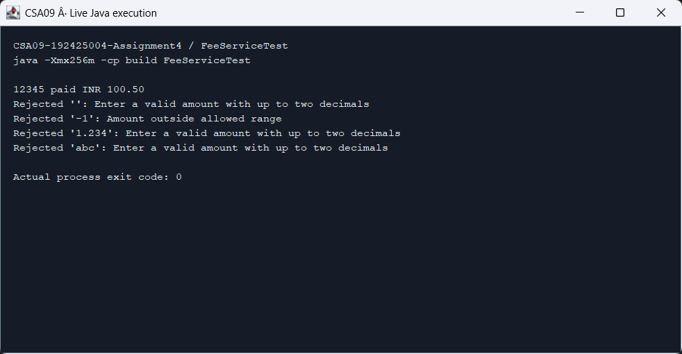
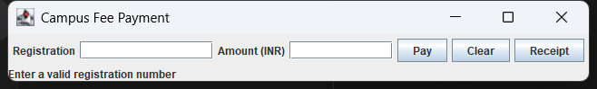
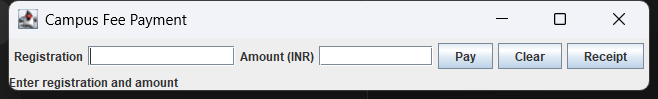
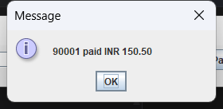

# Task01

[Written answers](ANSWERS.md) · [Test input](input/README.md)

Registration 90001 and INR 150.50. Empty ID, malformed amounts, clear and receipt.

Build with the [repository instructions](../README.md), then execute from that repository root.

```powershell
java -cp build FeeServiceTest
java -cp build FeeWindow
```

- [gui-run.txt](evidence/gui-run.txt)
- [service.txt](evidence/service.txt)

## Genuine execution captures











