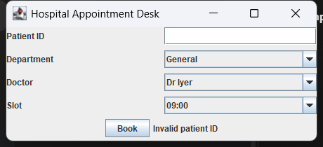
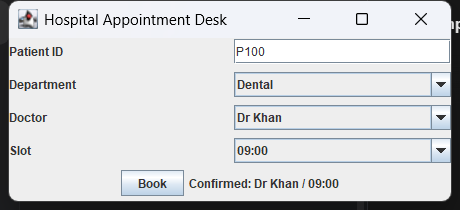

# Task02

[Written answers](ANSWERS.md) · [Test input](input/README.md)

Empty or P100 patient ID, switch General to Dental, select the doctor and reserve 09:00.

Build with the [repository instructions](../README.md), then execute from that repository root.

```powershell
java -cp build AppointmentDesk
```

- [close-confirmation.txt](evidence/close-confirmation.txt)
- [gui-run.txt](evidence/gui-run.txt)

## Genuine execution captures






