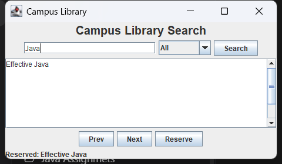
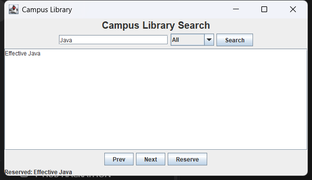

# Task03

[Written answers](ANSWERS.md) · [Test input](input/README.md)

Search Java, select Effective Java, reserve, resize to 480×280, 640×370 and 820×500.

Build with the [repository instructions](../README.md), then execute from that repository root.

```powershell
java -cp build LibrarySearch
```

- [gui-run.txt](evidence/gui-run.txt)

## Genuine execution captures






