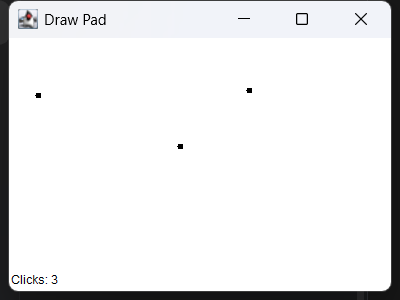
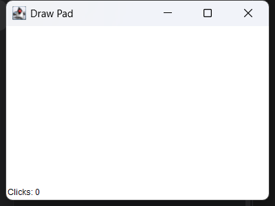
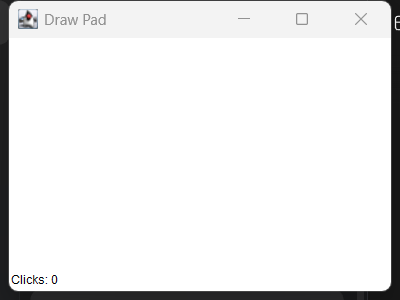

# Task04

[Written answers](ANSWERS.md) · [Test input](input/README.md)

Three mouse clicks on the canvas followed by iconification and restore. With and without @Override on misspelling.

Build with the [repository instructions](../README.md), then execute from that repository root.

```powershell
java -cp build DrawPad
```

- [gui-run.txt](evidence/gui-run.txt)
- [misspelled-callback.txt](evidence/misspelled-callback.txt)
- [no-annotation-compile.txt](evidence/no-annotation-compile.txt)
- [override-compiler-error.txt](evidence/override-compiler-error.txt)

## Genuine execution captures









