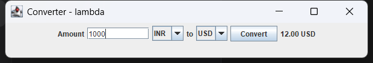
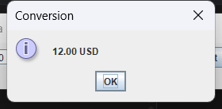
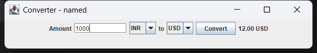
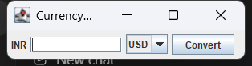

# Task05

[Written answers](ANSWERS.md) · [Test input](input/README.md)

Enter 1000 INR/USD and bad as an invalid amount. Compare original/changed requirements and four listener strategies.

Build with the [repository instructions](../README.md), then execute from that repository root.

```powershell
java -cp build Converter
java -cp build ConverterStyles lambda
```

- [gui-run.txt](evidence/gui-run.txt)

## Genuine execution captures













