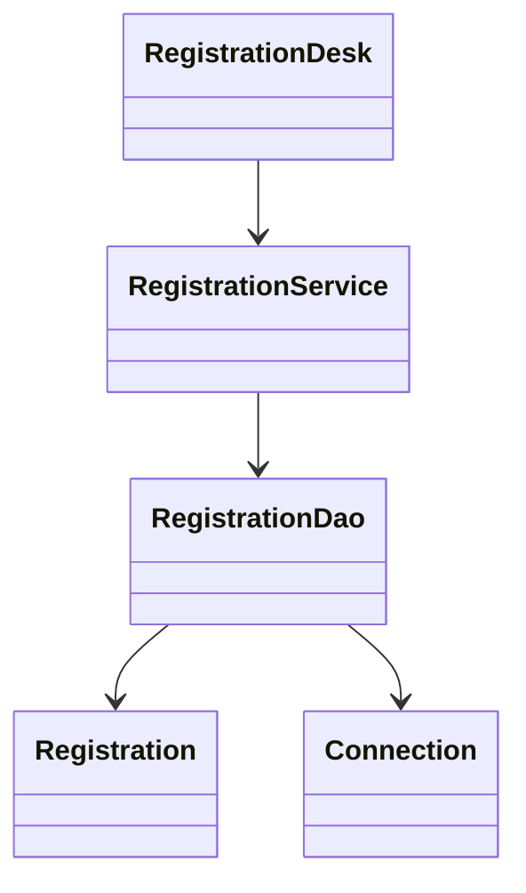

# Task 6 · Campus event registration

## 1. Requirements

Students submit registration number, name and event. Committee members view read-only records, select an event, page and export. A valid record inserts once. A missing or invalid value is rejected. A duplicate student/event is rejected even when simultaneous writes occur. Slow queries must leave the EDT able to redraw and move the window.

## 2. Screen and events

```text
[JFrame: File → Export CSV / Close]
[Registration] [Name] [Event] [Register]
[JTable: registration | student | event]
[Event Filter] [Prev] [Next] [Status]
Register → validator → worker → status + refreshed table
Filter → first page worker → JTable
Export → save chooser → worker → row count
```

## 3–4. Design



```text
ALGORITHM Register
    CAPTURE fields on EDT
    RUN background service validation and parameterized INSERT
    IF duplicate key THEN show duplicate on EDT
    ELSE IF invalid or I/O failure THEN show reason on EDT
    ELSE refresh current filter from page 1
END ALGORITHM

ALGORITHM Filter
    CAPTURE selected event and resolve desired offset
    QUERY first page of selected event in worker with LIMIT and OFFSET
    IN EDT replace rows, update page controls and display status
END ALGORITHM
```

Validation belongs in the service. The database UNIQUE constraint resolves races that pre-checks alone cannot prevent. JDBC calls, result collection and export occur outside the EDT, and only widget changes occur in done. A noneditable table prevents untracked mutations. An index on event plus ID supports filtered paging.

## 5. Verification and alternatives

Try valid numeric ID/name, missing name or nonnumeric ID, then submit the same ID/event pair again. The correct outcomes are one saved row, validation failure and duplicate-key feedback. An all-at-once model stores and transfers O(n) rows including 100,000 in the stated scenario. It can keep SQL on a worker, but publishing a huge model on the EDT can stall interaction. Paging holds O(p) rows for page size p, with O(p) client transfer per query. An indexed range uses approximately O(log n + offset + p) database work because offset rows can still be visited. Deep pagination can use the last ID as a cursor. Export intentionally handles the full selected result. For bounded driver buffering, enable Connector/J cursor fetching in the URL and use the positive fetch size.
