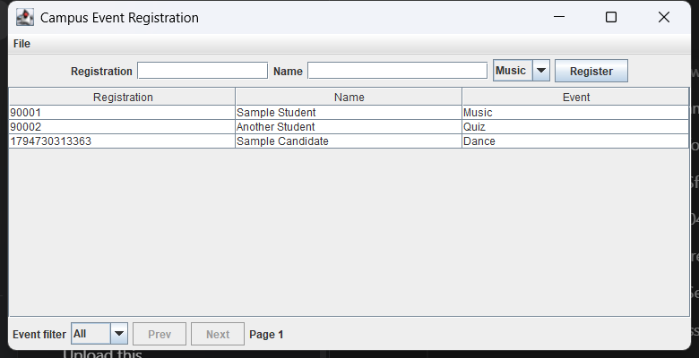
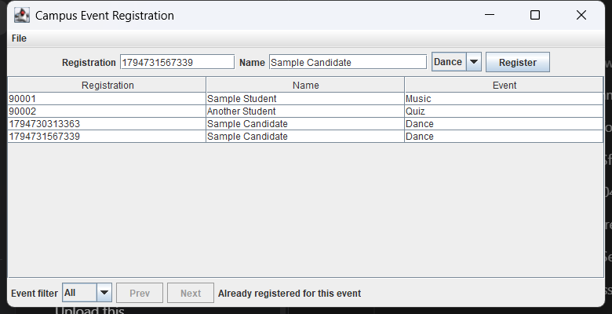
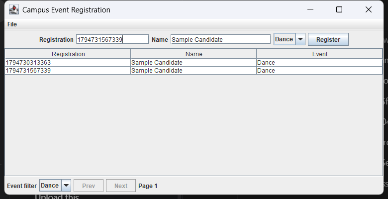
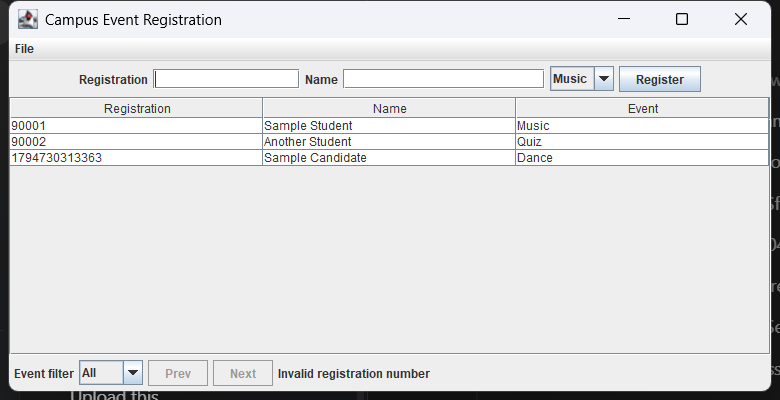
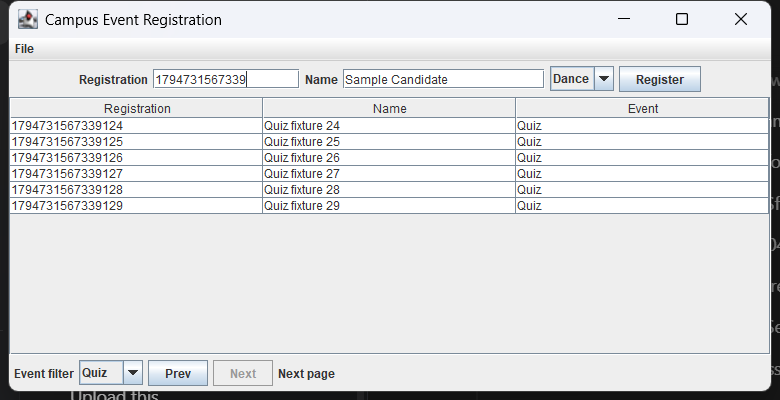
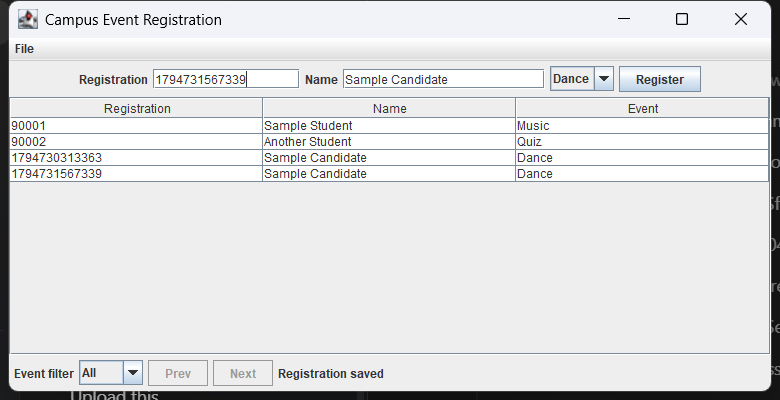

# Task06

[Written answers](ANSWERS.md) · [Test input](input/README.md)

Synthetic name and numeric identifier, invalid empty request, duplicate same event, Dance filter and CSV export.

Build with the [repository instructions](../README.md), then execute from that repository root.

```powershell
java -cp "build;PATH_TO_CONNECTOR_JAR" RegistrationDesk
```

- [gui-run.txt](evidence/gui-run.txt)
- [paging-export.txt](evidence/paging-export.txt)

## Genuine execution captures













