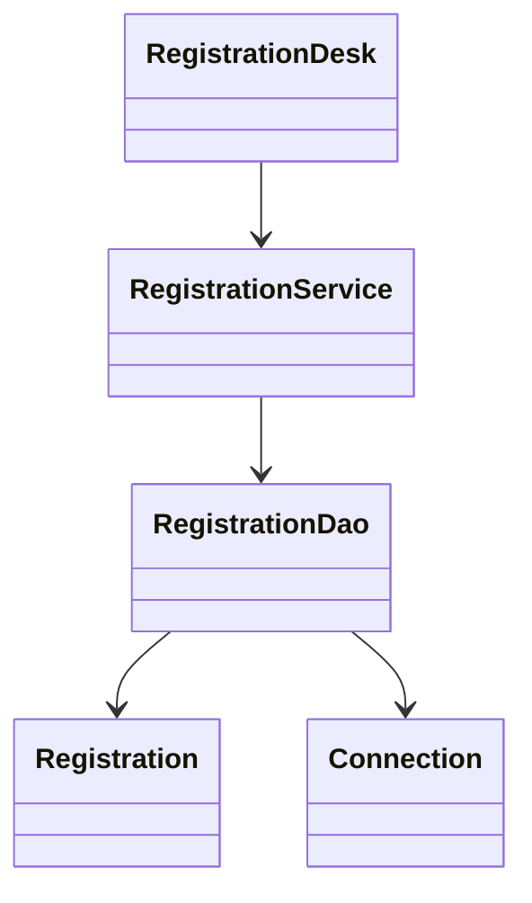

# CSA09 Programming in Java · Assignment 4

Aftan Faiz · 192425004 · CO4

GitHub repository [CSA09-192425004-Assignment4](https://github.com/AFTAN18/CSA09-192425004-Assignment4).

## Task 1 · Fee window

### 1.1 Diagnosis

The listener combines widget access, validation, database code and bank confirmation, making rules hard to test independently. Comparing action command strings with == can miss equal text in separate objects. Empty or invalid amounts can throw and negative amounts can slip through. SQL and sleep on the EDT freeze input and painting. Console feedback is invisible to a window user. The Receipt button falls into the Clear branch. String-concatenated SQL permits injection, and an unclosed connection/statement consumes resources. Failure to handle checked exceptions prevents compilation, and the missing window-close policy can leave the process open.

### 1.2 Repair

```text
FeeWindow → FeeService → Ledger → JDBC
EDT action → validate and persist in worker → EDT updates status
```

BigDecimal preserves cent accuracy. A prepared statement uses values as parameters, and try-with-resources closes JDBC resources. Clear, receipt and pay have dedicated listeners. The Pay button is disabled while one request is pending. The service has a replaceable persistence interface and a console test. Run without database settings for a demonstration ledger or configure the isolated database for actual persistence.

### 1.3 Defence

A fee rule can be tested against an in-memory ledger without opening a window. The frame can change layout independently. Background database work leaves Swing free to handle input. Different actions receive distinct behavior and explicit user feedback.

A unified linear dispatcher can compare up to k commands and uses one listener instance plus O(k) branches. Separate registered listeners route each event in O(1) application dispatch with O(k) listener references/objects in the general case. Database work and its memory cost are separate from dispatch.

## Task 2 · Hospital appointment desk

| Source | Event | Listener | Action |
|---|---|---|---|
| Department JComboBox | ActionEvent | ActionListener | Replace doctor model |
| Book JButton | ActionEvent | ActionListener | Validate then attempt booking |
| Frame | WindowEvent | WindowAdapter | Log open, confirm close during booking, dispose, log closed |

```text
JFrame (BorderLayout)
├─ JPanel CENTER (GridLayout)
│  ├─ JLabel + JTextField patient
│  ├─ JLabel + JComboBox department
│  ├─ JLabel + JComboBox doctor
│  └─ JLabel + JComboBox time
└─ JPanel SOUTH (FlowLayout) → JButton Book, JLabel status

ALGORITHM RefreshDoctors(department)
    doctors ← CACHE GET department OR empty list
    REPLACE doctor control model with doctors
    SELECT first valid doctor if one exists
END ALGORITHM

ALGORITHM RegisterAppointment(patient, doctor, time)
    IF fields invalid THEN DISPLAY error AND RETURN
    DISABLE booking button AND mark request pending
    TRY reserve doctor/time atomically
    DISPLAY confirmation OR conflict
    CLEAR pending AND ENABLE booking
END ALGORITHM
```

Swing invokes the constructor and initial refresh on the EDT, then setVisible posts windowOpened. Selecting Dental triggers actionPerformed and refreshDoctors. Book starts a fixture timer, which updates status and logs completion. Window close triggers windowClosing, which can confirm if pending, and dispose posts windowClosed. Applets were host-driven through init/start/stop/destroy, with painting invoked as needed. A Swing frame owns window lifecycle and component listeners. The simulated record store is shared only within the current frame.

A cached map uses O(d+m) references for d departments and m doctors and expected O(1) lookup plus O(k) model population for k doctors. A JDBC-on-change design queries an index by department using parameters on a worker, discards responses superseded by newer selections and populates the model. It needs O(k) active client space, approximately O(log m+k) indexed database work and network latency per change. Cached values need a refresh rule.

## Task 3 · Adaptive library layout

```text
JFrame / BorderLayout
├─ NORTH: header / BorderLayout
│  ├─ NORTH: title
│  └─ CENTER: query / FlowLayout → search text, category, Search
├─ CENTER: JScrollPane → results JTextArea
└─ SOUTH: footer / BorderLayout
   ├─ NORTH: actions / FlowLayout → Prev, Next, Reserve
   └─ SOUTH: status
```

BorderLayout reserves preferred-height header and footer and gives remaining space to the scroll pane. FlowLayout keeps controls at preferred sizes at the tested widths. A minimum width prevents the tested query row from clipping. GridLayout would force equal cells and CardLayout would display one card, so neither helps here. Tests search for Java, navigate to the second match and reserve it. The resize check compares control sizes and the result area over three window sizes.

GridBagLayout can set center weightx/weighty to one and use BOTH fill for the scroll pane, leaving zero vertical weights for controls. It can flatten some containers, but carries per-component constraints. A straightforward single layout pass across k widgets is O(k); GridBag's row/column constraint passes have larger constants and depend on grid spans. Nested layouts here use O(k) widget state and O(1) extra panel count. Absolute placement also stores O(k) bounds and initial placement takes O(k), but manual resizing requires custom O(k) updates and fails to adapt by default to fonts or locale.

At 480×280, 640×370 and 820×500 the result pane was 462×119, 622×209 and 802×339 pixels. The Reserve button stayed 81×26 at all sizes.

## Task 4 · Draw pad forensics

1. AWT calls mouseClicked with capital C. The lower-case method is a distinct method, so MouseAdapter's empty implementation handles the event. Even if invoked, the original changes count but never calls status.setText.
2. Fix the spelling, click several times, minimize using the window controls, then restore or cover and uncover the surface. Immediate getGraphics painting is lost when the window system invalidates and repaints the surface because no points are saved.
3. The completed callback stores each point, updates the label and requests a repaint. paint calls super then draws a six-pixel filled circle centered on each stored point. The screenshot test clicks three positions and verifies that the count and dot pixels survive iconification and restoration.
4. Compile the misspelled adapter twice. Without Override it is a legal unrelated method and compiles without a diagnostic. With Override, javac rejects it. Compare both genuine compiler results.

An off-screen BufferedImage can accumulate dots by rendering each new click into the raster and then blitting it during paint. Point storage uses O(n) space and repaint takes O(n) draw operations. The raster uses O(width × height) space and copying a full raster can take O(width × height) pixel work independent of n. It also needs a resize policy. Point coordinates can be replayed at a new size or exported independently.

## Task 5 · Currency converter listeners

The executable comparison selects frame listener, named inner class, anonymous inner class or lambda. Each invokes the shared conversion operation and uses WindowAdapter to dispose. The supplied lambda TODO demo is a separate executable with a fixed INR source. Its button and Enter share one listener, and the label shows two decimal places or Invalid amount. The four-style changed requirement adds two shared behavior lines: register the same listener on the amount field, and display a JOptionPane for the result. The handler bodies need no edits for any style. Run a style with argument original to observe the button-only, label-only baseline.

| Style | Readability and frame access | Reuse |
|---|---|---|
| Frame | Direct fields, but frame implements the action role | Entire frame only |
| Named inner | Explicit type and access to fields | Reusable in multiple registrations on frame |
| Anonymous | Inline explicit callback with captured window | Reusable through the stored reference |
| Lambda | Short delegation with a captured window | Reusable through ActionListener reference |

For a large application use a shared Swing Action per command to centralize labels, enabled state and keyboard bindings. A method reference requires a signature accepting ActionEvent or a small adapter method. It supplies one reusable listener per binding group when stored once. With k triggers and one shared listener or Action, space is O(k) registrations plus O(1) handler state. Separate listener instances also have O(k) objects. Adding a trigger is one O(1) registration or binding; conversion uses constant numeric work plus O(L) parsing of input length L.

## Task 6 · Campus event registration

### 1. Requirements

Students submit registration number, name and event. Committee members view read-only records, select an event, page and export. A valid record inserts once. A missing or invalid value is rejected. A duplicate student/event is rejected even when simultaneous writes occur. Slow queries must leave the EDT able to redraw and move the window.

### 2. Screen and events

```text
[JFrame: File → Export CSV / Close]
[Registration] [Name] [Event] [Register]
[JTable: registration | student | event]
[Event Filter] [Prev] [Next] [Status]
Register → validator → worker → status + refreshed table
Filter → first page worker → JTable
Export → save chooser → worker → row count
```

### 3–4. Design



```text
ALGORITHM Register
    CAPTURE fields on EDT
    RUN background service validation and parameterized INSERT
    IF duplicate key THEN show duplicate on EDT
    ELSE IF invalid or I/O failure THEN show reason on EDT
    ELSE refresh current filter from page 1
END ALGORITHM

ALGORITHM Filter
    CAPTURE selected event and resolve desired offset
    QUERY first page of selected event in worker with LIMIT and OFFSET
    IN EDT replace rows, update page controls and display status
END ALGORITHM
```

Validation belongs in the service. The database UNIQUE constraint resolves races that pre-checks alone cannot prevent. JDBC calls, result collection and export occur outside the EDT, and only widget changes occur in done. A noneditable table prevents untracked mutations. An index on event plus ID supports filtered paging.

### 5. Verification and alternatives

Try valid numeric ID/name, missing name or nonnumeric ID, then submit the same ID/event pair again. The correct outcomes are one saved row, validation failure and duplicate-key feedback. An all-at-once model stores and transfers O(n) rows including 100,000 in the stated scenario. It can keep SQL on a worker, but publishing a huge model on the EDT can stall interaction. Paging holds O(p) rows for page size p, with O(p) client transfer per query. An indexed range uses approximately O(log n + offset + p) database work because offset rows can still be visited. Deep pagination can use the last ID as a cursor. Export intentionally handles the full selected result. For bounded driver buffering, enable Connector/J cursor fetching in the URL and use the positive fetch size.

## Completion checklist

- [x] Six task folders and answers.
- [x] Compiled all applications and ran the GUI evidence harness.
- [x] Verified three library sizes, draw-pad repaint and four converter styles.
- [x] Exercised registration against disposable MySQL.
- [x] Saved genuine desktop screenshots and execution logs.
